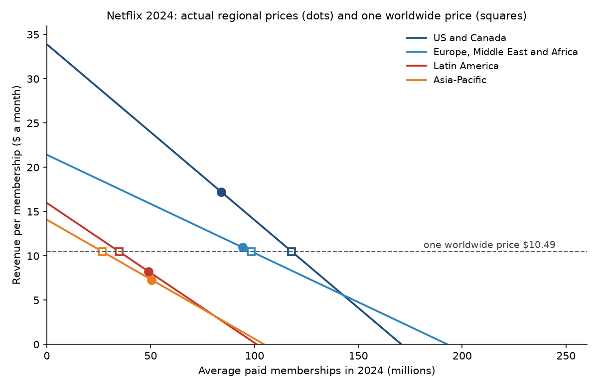
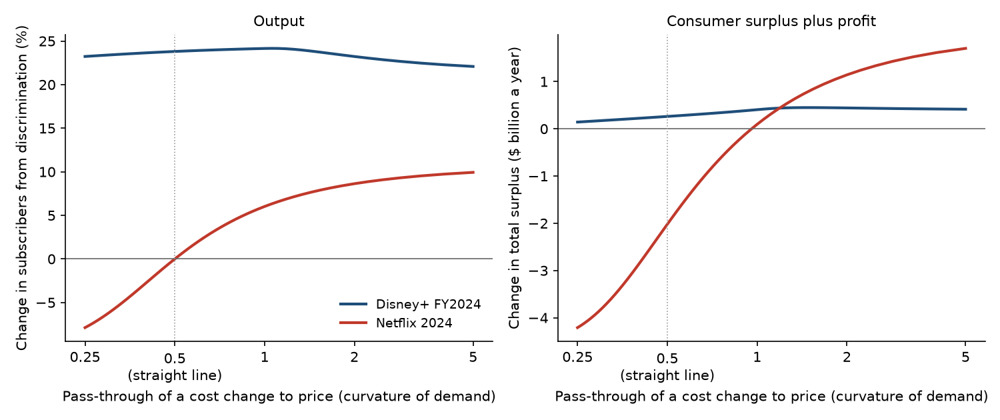

# What Netflix Charges the World

### In 1981, Richard Schmalensee asked when a seller who charges different customers different prices leaves the world better off. I asked again, using what Netflix and Disney+ charge around the world.

---

Netflix's help pages list its Standard plan at $19.99 a month in the United States. In 2024, Netflix took in an average of $17.20
a month from each of the 84 million paying memberships it averaged in the United States and Canada. It took in $10.96 from each
membership in Europe, the Middle East and Africa, $8.24 in Latin America and $7.29 in Asia-Pacific. Its annual
report says that at the end of 2024 its plans ranged from the equivalent of $1 to $32 a month, depending on the
country and the plan. Disney's spread is wider still. In the year to September 2024, a Disney+ subscriber in the
United States and Canada brought in $7.89 a month, one in the rest of the world outside the Hotstar markets brought
in $6.60, and a Disney+ Hotstar subscriber in India and parts of Southeast Asia brought in 96 cents.

The cost of streaming one more month of shows to one more household is small next to any of these prices, so the
differences are mostly about what each market will bear. Economists call this third-degree price discrimination,
which means sorting customers into groups by something the seller can see, here the country they sign up from, and
charging each group a different price. Whether the world is better or worse off for it is an old question with a
surprisingly sharp answer, and the sharpest version of the answer comes from an MIT economist named Richard
Schmalensee.

---

## Charging by the country

A company with pricing power that must charge one price picks a price that loses some customers in poorer markets
and leaves money on the table in richer ones. Letting it charge by market changes two things. Some customers pay
less and some pay more, so the same output is split differently among them, and the total number of people served
can go up or down.

Schmalensee showed that the second effect decides the matter. Under one price every buyer values the last unit
the same, and under several prices they don't, so discrimination always splits a given output less efficiently.
It can raise total welfare, meaning consumer surplus plus the company's profit, only if it raises total output by
enough to make up for that. Hal Varian later turned this into a ceiling on the gain:

```math
\Delta W \;\le\; (\bar p - c)\,\sum_i \Delta q_i
```

Here $`\Delta W`$ is welfare under discrimination minus welfare under one price, $`\bar p`$ is the single
profit-maximizing price, $`c`$ is the cost of serving one more customer, and $`\Delta q_i`$ is the change in
customers in market $`i`$. For Disney+ in fiscal 2024 the single price works out to $7.10 a month, the marginal cost
I use is 50 cents, and discrimination keeps 36.75 million Hotstar subscribers who would leave at $7.10:

```math
(\$7.10 - \$0.50) \times 36.75\ \text{million} \times 12 = \$2.91\ \text{billion a year}
```

For Netflix the change in total customers turns out to be zero, so the ceiling is zero and welfare can only fall.
The three possible cases look like this:

| When discrimination changes total output by | Ceiling on the welfare change | What follows |
|---|---|---|
| Less than zero | Negative | Welfare falls |
| Zero | Zero | Welfare falls, because the same output is split less efficiently |
| More than zero | Positive | Welfare can rise, but need not |

The middle row is the straight-line case. When demand curves are straight lines and the seller serves every
market either way, discrimination leaves total output exactly where it was, and the whole loss is a set of triangles, one per market, each half the price gap times the shift in customers:

```math
-\Delta W \;=\; \tfrac{1}{2}\sum_i \bigl|\,(p_i - \bar p)\,\Delta q_i\,\bigr|
```

where $`p_i`$ is the price actually charged in market $`i`$. In the United States and Canada, Netflix's average of
$17.20 sits $6.71 above the single price of $10.49, and the fitted demand line says 33.79 million more memberships
would exist there at the lower price:

```math
\tfrac{1}{2} \times \$6.71 \times 33.79\ \text{million} \times 12 = \$1.36\ \text{billion a year}
```

Adding the triangles for the other three regions gives a total loss of $2.02 billion a year.

---

## Richard Schmalensee's question

Richard Schmalensee was a professor at MIT's Sloan School of Management when the *American Economic Review*
published his six-page paper, "Output and Welfare Implications of Monopolistic Third-Degree Price
Discrimination," in March 1981. He later served on the President's Council of Economic Advisers from 1989 to 1991,
co-edited the *Handbook of Industrial Organization*, and ran the Sloan School as dean from 1998 to 2007. His
research has centered on antitrust and regulation, and he has advised the Federal Trade Commission and the Justice
Department.

The question was already old. Arthur Pigou proved in 1920 that with straight-line demands and every market
served, discrimination leaves total output unchanged and so lowers welfare, and Joan Robinson's 1933 book on
imperfect competition showed that the curvature of demand decides what happens otherwise. Schmalensee took
Robinson's analysis forward for markets with independent demands and a constant cost per unit. His method was to
start from one price and relax the limit on price differences a step at a time, tracking output and welfare along
the way, which showed how curvature sets the direction of the output effect and why output has to rise for
welfare to rise. Pigou's straight-line result takes four lines. Suppose market $`i`$ has demand
$`q_i = a_i - b_i p_i`$, the seller's cost per unit is $`c`$, every market buys something at the single price,
and a discriminating seller sets marginal revenue $`MR_i`$ equal to $`c`$ in each market:

```math
\begin{aligned}
\text{discrimination } (MR_i = c):\quad q_i^{d} &= \tfrac{1}{2}\,(a_i - b_i c) \\
\text{one price:}\quad \bar p &= \frac{\sum_i a_i + c\sum_i b_i}{2\sum_i b_i} \\
\sum_i q_i(\bar p) &= \sum_i a_i - \bar p \sum_i b_i \\
&= \tfrac{1}{2}\Bigl(\sum_i a_i - c\sum_i b_i\Bigr) = \sum_i q_i^{d}
\end{aligned}
```

Total output is the same under both regimes, so by Varian's ceiling the welfare change cannot be positive, and since
the split is less efficient it is negative.

Varian, building on Schmalensee, proved the output condition in full generality in the same journal in 1985, as
the pair of bounds used here. The strongest objection since is that the condition is only necessary, and that
whether output rises depends on something data rarely reveal, the curvature of demand. In 2010 Iñaki Aguirre,
Simon Cowan and John Vickers showed that discrimination raises welfare when the prices are not too far apart and
inverse demand in the low-price market is more convex than in the high-price one, and they gave matching
conditions under which it lowers welfare. Cowan's later papers carried these conditions to wider families of
demand curves. A second
line of work, starting with Jerry Hausman and Jeffrey MacKie-Mason in 1988, stressed that when one price would
shut a market out, discrimination that lets the seller serve it can leave every group at least as well off.

The question has not gone away. On May 12, 2025, President Donald Trump signed an executive order on "most-favored-nation"
pricing, which seeks to bring what Americans pay for prescription drugs into line with what drug companies charge
in other wealthy countries. Pushed far enough, that is a request to stop pricing by country, and Schmalensee's
analysis says its effect on welfare turns on how many patients would gain or lose access.

---

## How I tested it

Netflix and Disney report, in their 10-K annual reports, the average monthly revenue they collect per subscriber
in each region and the number of subscribers there. I treat revenue per subscriber as the region's price and
average subscribers over the year as its quantity. That gives four Netflix markets in each year from 2017 to 2024
and three Disney+ markets in fiscal 2022 to 2024. Netflix stopped reporting membership numbers after 2024.

I kept Schmalensee's assumptions of one seller, independent markets and a constant marginal cost that is the same
everywhere. The cost is 50 cents a month, an allowance for the costs Netflix lists as growing with members
(streaming delivery, payment processing and customer service), with $0, $1 and $2 as checks. I assume each regional
price maximizes profit in that region. A seller stops at a price only where marginal revenue equals marginal cost,
so one observed point pins down a straight-line demand curve for each region, and the single price solves the
pooled problem:

```math
\begin{aligned}
b_i &= \frac{q_i}{p_i - c}, \qquad a_i = q_i + b_i\,p_i \\
\bar p &= \arg\max_{P}\; (P - c)\sum_i \max\{a_i - b_i P,\ 0\}
\end{aligned}
```

The test is Schmalensee's condition. The null hypothesis is that discrimination does not raise output, and under
it welfare falls:

```math
H_0:\ \sum_i \Delta q_i \le 0 \;\Longrightarrow\; \Delta W < 0
```

The inputs are company totals rather than samples, so there are no standard errors. The uncertainty is in the
assumptions, and I vary them instead. For the extension, following Aguirre, Cowan and Vickers, I refit every demand
curve under a family of shapes indexed by $`\delta`$, with pass-through $`\rho`$, the share of a cost increase a
profit-maximizing seller passes on to buyers:

```math
p_i(q) = A_i - B_i\,q^{\delta}, \qquad \rho = \frac{1}{1+\delta}
```

A straight line is $`\delta = 1`$ and $`\rho = 0.5`$. Values of $`\rho`$ above one half mean convex demand. All of
these rules were written into the code before I looked at results.

---

## With straight-line demand, one Netflix price would leave subscribers unchanged and the world $2 billion better off

With Netflix's 2024 numbers the profit-maximizing single price is $10.49 a month, and every region keeps
subscribing at it.

| Region | Actual average | Subscribers (millions) | Subscribers at $10.49 | Consumers' gain from discrimination | Netflix's gain |
|---|---|---|---|---|---|
| US and Canada | $17.20 | 84.1 | 117.9 | −$8.13 billion | +$2.72 billion |
| Europe, Middle East, Africa | $10.96 | 94.2 | 98.4 | −$0.54 billion | +$0.02 billion |
| Latin America | $8.24 | 49.0 | 34.7 | +$1.13 billion | +$0.38 billion |
| Asia-Pacific | $7.29 | 50.5 | 26.7 | +$1.48 billion | +$0.91 billion |
| Total | | 277.7 | 277.7 | −$6.06 billion | +$4.04 billion |

*Gains are per year, actual regional prices compared with one price of $10.49.*

```math
\begin{aligned}
\bar p &= \$10.49, \qquad \textstyle\sum_i \Delta q_i = 0 \\
\Delta CS &= -\$6.06\ \text{bn}, \qquad \Delta \pi = +\$4.04\ \text{bn} \\
\Delta W &= -\$2.02\ \text{bn a year} \in [-\$4.04,\ \$0]\ \text{bn (Varian)}
\end{aligned}
```

The subscriber totals match to the decimal, which is Pigou's and Schmalensee's result on real numbers. About 38.0
million memberships in the US-Canada and European regions are priced out by discrimination and the same number are
priced in across Latin America and Asia-Pacific. Consumers as a whole lose $6.06 billion a year ($`\Delta CS`$),
Netflix gains $4.04 billion ($`\Delta\pi`$), and the net loss of $2.02 billion is 5.2% of Netflix's 2024 streaming
revenue of $39.0 billion.



The cost assumption barely matters. At a marginal cost of zero the loss is $1.94 billion a year, and at $2 it is
$2.33 billion. Total memberships are unchanged in every case, because each region's demand line reaches zero above
the single price (at a cost of 50 cents, the lowest of these cutoffs is $14.08 a month, in Asia-Pacific).

---

## The cost of the price gap has grown with the gap

In 2017 Netflix charged the world much more nearly one price, with its highest regional average 1.23 times its
lowest. By 2024 the ratio was 2.36, as the US-Canada average rose 73% and the Asia-Pacific average fell.

| Year | US and Canada | Asia-Pacific | Highest ÷ lowest region | Single price | Welfare loss | Loss as share of revenue |
|---|---|---|---|---|---|---|
| 2017 | $9.97 | $9.11 | 1.23 | $9.37 | $0.04 billion | 0.3% |
| 2019 | $12.57 | $9.24 | 1.53 | $10.52 | $0.27 billion | 1.4% |
| 2021 | $14.56 | $9.56 | 1.88 | $11.04 | $0.80 billion | 2.7% |
| 2023 | $16.28 | $7.64 | 2.13 | $10.70 | $1.36 billion | 4.0% |
| 2024 | $17.20 | $7.29 | 2.36 | $10.49 | $2.02 billion | 5.2% |

*From 2017 to 2022 the cheapest region was Latin America. Straight-line demand, marginal cost of 50 cents.*

Under straight lines the loss grows with the square of the price gaps, so a doubling of the spread does far more
than double the cost. In none of the eight years would one price have pushed a region out, so every year falls in
Schmalensee's welfare-reducing case. The single price stayed between $9.37 and $11.04 throughout, which means the
spread widened from both ends, with higher prices in the richest market and lower ones in the fastest-growing.

---

## Disney+ Hotstar is the case where discrimination helps

Disney's gap is too wide for one price to cover. A Disney+ Hotstar subscriber paid an average of 96 cents a month
in fiscal 2024, against $7.89 in the United States and Canada.

| Fiscal year | US and Canada | International | Hotstar | Single price | Hotstar subscribers kept | Welfare gain |
|---|---|---|---|---|---|---|
| 2022 | $6.34 | $6.10 | $0.88 | $6.21 | 52.3 million | +$0.36 billion |
| 2023 | $6.97 | $5.93 | $0.66 | $6.33 | 49.5 million | +$0.11 billion |
| 2024 | $7.89 | $6.60 | $0.96 | $7.10 | 36.8 million | +$0.26 billion |

*Straight-line demand, marginal cost of 50 cents. Subscribers are averages over the fiscal year.*

```math
\begin{aligned}
\bar p &= \$7.10, \qquad \textstyle\sum_i \Delta q_i = +36.75\ \text{million} \\
\Delta W &= +\$0.26\ \text{bn a year} \in [\$0.12,\ \$2.91]\ \text{bn (Varian)}
\end{aligned}
```

The straight line fitted to Hotstar's market reaches zero at $1.42, so at one price of $7.10 it would have no
subscribers. Facing one price, Disney would rather serve the United States, Canada and the rest of the world and
give up the Hotstar market, and discrimination is what opens it. Varian's lower bound, which uses only the
discriminatory margins, is positive, so the gain holds for any concave consumer valuation that produces these
quantities. Hotstar subscribers gain, Disney gains, and between American and international Disney+ subscribers
the shift roughly cancels, with the American side losing $0.51 billion of consumer surplus and the
international side gaining $0.38 billion. This is Hausman and MacKie-Mason's market-opening case, and it puts Disney+ on the other side of
Schmalensee's condition from Netflix.

---

## Whether Netflix's price gap helps depends on the shape of demand

The straight line is the knife-edge case, and when the curvature is allowed to vary the Netflix answer changes
sign.

| Shape of demand | Pass-through | Single price | Subscribers gained by discrimination | Change in welfare |
|---|---|---|---|---|
| Strongly concave | 0.25 | $8.96 | −21.9 million | −$4.21 billion |
| Concave | 0.33 | $9.55 | −13.9 million | −$3.51 billion |
| Straight line | 0.50 | $10.49 | 0 | −$2.02 billion |
| Mildly convex | 0.67 | $11.10 | +8.5 million | −$1.00 billion |
| Exponential | 1.00 | $11.76 | +16.7 million | +$0.09 billion |
| Strongly convex | 2.00 | $12.42 | +24.0 million | +$1.14 billion |

*Netflix 2024, marginal cost of 50 cents.*

```math
\Delta W = 0 \quad\text{at}\quad \delta^{*} = 0.04,\quad \sigma^{*} = 1 - \delta^{*} = 0.96,\quad \rho^{*} = 0.96
```

Here $`\sigma = -q\,p''(q)/p'(q)`$ is the curvature of inverse demand, zero for a straight line. Output rises with
discrimination whenever demand is convex, as the theory predicts, and welfare follows once the curvature is large
enough. The break-even point is almost exactly exponential demand, with curvature just under one. If Netflix's regional demand bends
at least that much, its price gap does more good than harm, and if it is closer to a straight line, more harm than
good.



The data in hand cannot settle the shape, but there is one reason to lean toward convex. Each region is a
collection of countries with prices from $1 to $32 a month, and adding up straight-line country demands with
different cutoffs gives a regional curve that flattens as the price falls and more countries come in. Robinson's
insight, that output rises when discrimination raises prices where demand is concave and cuts them where it is
convex, shows up when the regions are allowed to differ. With concave demand in the two high-price regions and
convex demand in the two low-price ones, discrimination adds 22.1 million subscribers and $0.93 billion a year in welfare, and with the
shapes reversed it removes 33.3 million subscribers and $5.95 billion. Disney+ comes out ahead in every version,
because opening the Hotstar market outweighs everything else.

---

## Why it matters

For consumers, the price gap is a transfer as much as a loss. Under the straight-line model, discrimination costs
American and Canadian Netflix subscribers $8.13 billion a year and saves Latin American and Asia-Pacific
subscribers $2.61 billion, with Netflix keeping much of the difference. The households that gain are the ones with
less to spend, which is the usual defense of pricing by country, and the data agree that they gain, though by less
than American and Canadian households lose.

For smaller streaming services, a company that can price country by country can grow in markets a single-price
company would abandon, as the Hotstar figures show. Doing that takes local billing, local content deals and
pricing data that the largest services already have and smaller ones mostly do not.

For policy, the Netflix and Disney numbers show that a rule requiring one price, for streaming or for medicines,
cannot be judged without asking which markets it would close. Where every market stays open under one price, the
Schmalensee test leans toward uniform pricing. Where one price would shut out a large, poor market, as with
Hotstar, discrimination is what keeps it served. A rule tying American drug prices to foreign ones would need the
same accounting, country by country, of which patients keep access.

---

## Limits of this study

Revenue per member averages over plans, ad tiers and dozens of countries, so it blends discrimination by country
with the plan menu inside each country, and Hotstar's figure includes advertising. The markets are regions, and
Netflix's own range of $1 to $32 a month shows the country spread is far wider than the regional averages. The
method assumes each regional price maximizes current profit, while both companies may price low in growing
markets to build a base. Demand in one region may depend on prices in another, through travel, VPNs or shared
shows. Libraries differ by country, so the products are not identical, and Netflix is not a monopolist. Above all,
the data fix one point on each demand curve, and everything about what one price would do comes from the curve
drawn through that point, which is why the curvature extension matters as much as the main result.

---

## Further reading

- [TECHNICAL.md](TECHNICAL.md) has the data, method, full results and reproduction steps.
- [results/FINDINGS.md](results/FINDINGS.md) has a plain-English summary and every table the scripts produce.
- [METHODS_REVIEW.md](METHODS_REVIEW.md) reviews the original paper's methods and claims.
- Richard Schmalensee, "Output and Welfare Implications of Monopolistic Third-Degree Price Discrimination,"
  *American Economic Review* 71(1), 1981, pp. 242–247.
- Hal R. Varian, "Price Discrimination and Social Welfare," *American Economic Review* 75(4), 1985, pp. 870–875.
- Iñaki Aguirre, Simon Cowan and John Vickers, "Monopoly Price Discrimination and Demand Curvature," *American
  Economic Review* 100(4), 2010, pp. 1601–1615.
- Simon Cowan, "Welfare-Increasing Third-Degree Price Discrimination," Oxford Department of Economics Discussion
  Paper 652, 2013, and "The Welfare Effects of Third-Degree Price Discrimination with Non-Linear Demand Functions,"
  Discussion Paper 364, 2007.
- Netflix, Inc., Form 10-K for 2019, 2022 and 2024, from the annual reports page at https://ir.netflix.net,
  downloaded November 1, 2026. The US plan price comes from Netflix's "Plans and Pricing" help page,
  https://help.netflix.com/en/node/24926, viewed the same day.
- The Walt Disney Company, fiscal 2023 and 2024 annual reports (Form 10-K), from https://thewaltdisneycompany.com,
  downloaded November 1, 2026.

*Brendyn Beasley*
